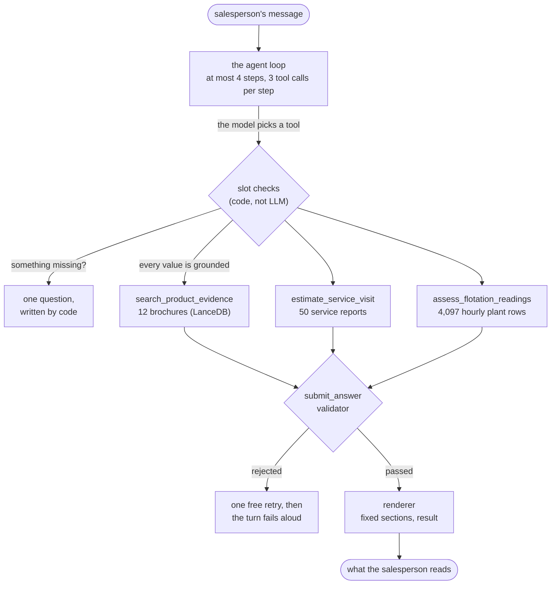

# Metso Sales Assistant

A command line assistant for a Metso salesperson who is on a call with a mining customer. The salesperson types a question. The agent decides what to do, looks the answer up in real data, and replies with the evidence it used. It answers product questions from the brochures, prices service visits from past service reports, and compares flotation readings against a real plant's history. It asks when something is missing, and it says so when the data does not have the answer. It never invents a specification, a price or a percentage.

## What was attempted

All three parts of the brief, including the optional one.

| Part | Asked for | Technique | Status |
|---|---|---|---|
| 1 | Answer product questions and recommend a product, from the brochures | Hybrid search over the brochures merged with RRF | Done |
| 2 | Estimate the cost of a field service visit, from past reports | Extract reports into a checked record once, then plain code provides the estimation | Done |
| 3 | Assess flotation readings against historical plant data (optional) | Compare the reading to one plant's 2017 hourly data with plain statistics | Done |


### Brochure search (`npm run eval:retrieval`)

12 hand labelled queries, plus one query that should find nothing.

```
recall@5  0.875
MRR       0.875
```

### End to end golden set (`npm run eval`)

23 cases, each run 3 times. 69 conversations, 75 turns.

```
Per metric (share of turns that pass)
  routing        96%
  clarification  95%
  numbers        96%
  abstention     93%
  safety         100%
  recall@5       1.000
  MRR            0.906
  grounding      83% (indicative, 6 judged)

Per category (pass@3 = at least one run passes, pass^3 = all three pass)
  product        pass@3 5/5   pass^3 5/5
  cost           pass@3 5/5   pass^3 4/5
  clarification  pass@3 3/4   pass^3 3/4
  out_of_scope   pass@3 2/2   pass^3 2/2
  composite      pass@3 2/2   pass^3 1/2
  injection      pass@3 2/2   pass^3 2/2
  flotation      pass@3 3/3   pass^3 2/3
  TOTAL          pass@3 22/23   pass^3 19/23

Average per turn: 7540 tokens, 2275 ms
```

### What the flotation data showed

For the brief's own readings, measured against 4,097 hourly rows from one iron ore plant in 2017:

```
3.1% silica    percentile 76.2    that plant was at or above 3.1% in 23.9% of its hours
64.5% iron     percentile 27.8    that plant was at or below 64.5% in 27.9% of its hours
both at once                      20.1% of its hours
plant medians  silica 2.00        iron 65.21
```

## How to run it

### 1. Check Node

Node 20.12 or newer. It was developed on Node 22.

```bash
node --version
```

### 2. Install

```bash
npm install
```

### 3. Add a Gemini API key

Copy the example file.

```bash
cp .env.example .env
```

Open `.env` and set `GEMINI_API_KEY=your-key`. 

### 4. Build the knowledge folder

This is the one step you cannot skip. It reads `data/` and writes `knowledge/`.


```bash
npm run ingest
```

That runs two scripts, one after the other:

- `npm run ingest:brochures` cuts the 12 brochures into pieces, embeds each piece with Gemini, and writes the search index to `knowledge/lancedb`. It takes a few minutes.
- `npm run ingest:services` sends each of the 50 service reports to Gemini, checks every value it returns against the report it came from, and writes `knowledge/service_records.json`. This is the slower and more expensive of the two. A report that fails its checks is retried up to three times.

Both print a summary when they finish. You can run either on its own.

### 5. Start chatting

```bash
npm run chat
```

Type a question and press enter. Type `exit` to quit. Try these:

```
We have Larox pressure filters but performance drops whenever our feed grade changes
A customer in Chile needs 12 filter cloths replaced on a Larox PF-DS tower press. What should I budget for the service visit?
The customer is getting 3.1% silica and 64.5% iron in their concentrate. They think that's normal. What do you think?
```

You can also feed it a file, one message per line:

```bash
npx tsx src/cli.ts < prompts.txt
```

### Running the evals

The two evals call Gemini. The brochure search eval works as soon as step 4 is
done:

```bash
npm run eval:retrieval
```

The golden set also uses a second, made-up index holding the prompt injection test pages. Build it once, then run the eval:

```bash
npm run ingest:eval
npm run eval
```

`npx tsx eval/run.ts --only <case-id>` runs a single case and prints what the agent actually did, which is the cheap way to look into one failure.

## How the agent works

### The shape of a turn



### How a message is routed

The model chooses the tool. Everything after that choice is code.

- **The model decides** which tool to call, and with what arguments. There is no keyword routing.
- **Code decides** whether the call may run. Each tool has required fields, and every required field needs a short quote from something the customer actually wrote. If a field has no value, or its quote does not hold that value, the field counts as missing.
- **Code writes the question.** When a field is missing, the customer gets one question from a fixed template, with the real choices filled in from the data. The model never writes the question.
- **The caps are fixed.** Four steps per turn, three tool calls per step, two clarifications per tool. On the last step the model is forced to submit an answer.
- **Failure is explicit.** If an answer cannot pass the validator twice, the turn ends by saying so and listing what was found. It does not fall back to a guess.


### The three tools

| Tool | Source of truth | What it never does |
|---|---|---|
| `search_product_evidence` | The 12 brochures, as a hybrid search over a local LanceDB index | Answer on its own. It returns pages and their ids. |
| `estimate_service_visit` | The 50 service reports | Convert between currencies, or add up figures across different part numbers |
| `assess_flotation_readings` | 4,097 hourly rows from one plant | Say what is normal, or claim one reading causes another |

Search runs a vector search and a keyword search at the same time and merges the two rankings with Reciprocal Rank Fusion. The estimator works in whole cents, groups by currency and by part number, and writes its own limitations. The flotation tool rounds every figure it returns, so the words the model writes can match the data exactly.


